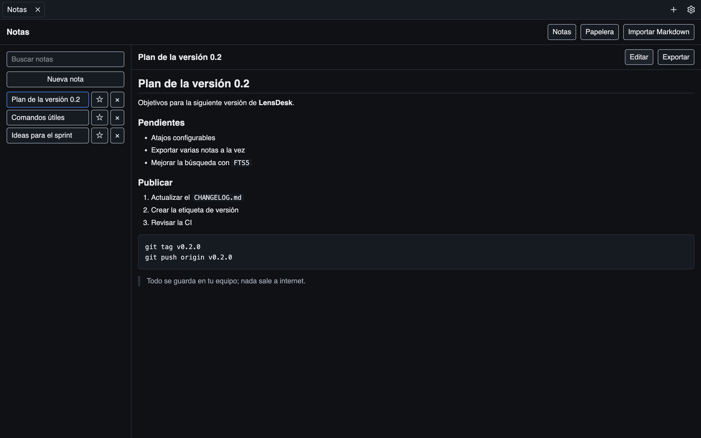
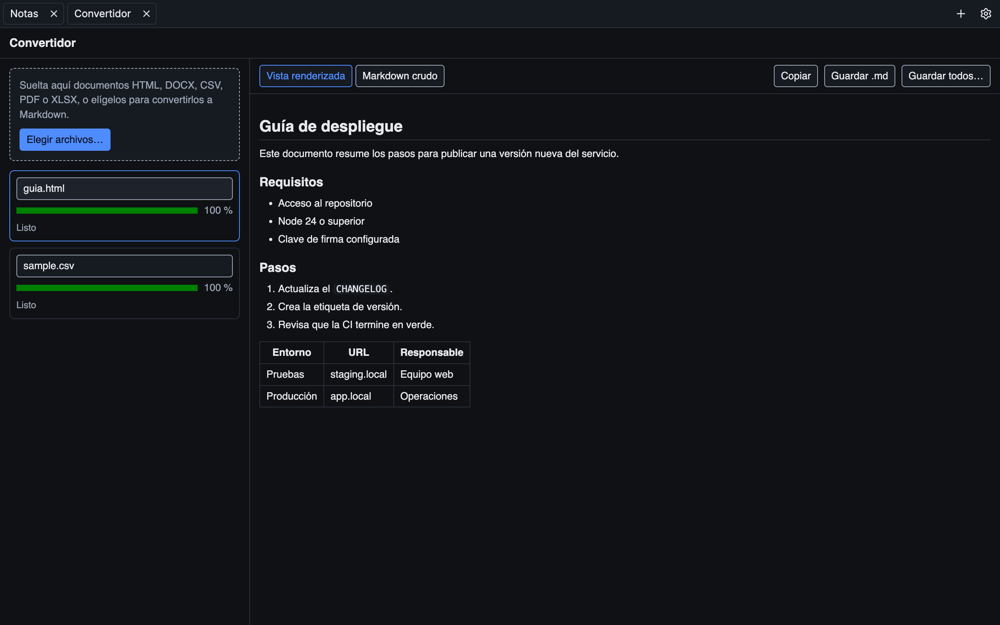
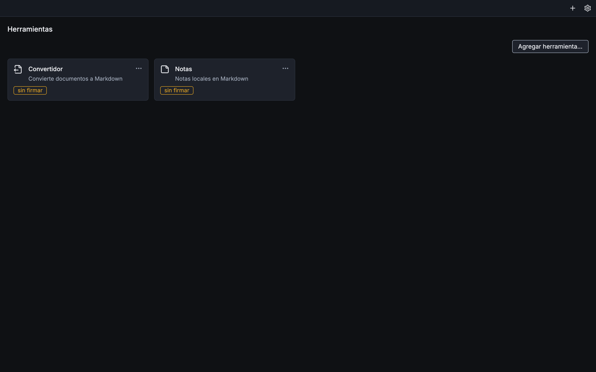

<div align="center">

# LensDesk

**Un escritorio de herramientas para desarrolladores: modular, con pestañas y 100 % local.**

[](https://github.com/LensSystems/LensDesk/actions/workflows/ci.yml)
[](https://github.com/LensSystems/LensDesk/releases)
[](LICENSE)


[English](#lensdesk-english)

</div>

---

<div align="center">



</div>

LensDesk es una aplicación de escritorio que reúne tus utilidades de desarrollo en una sola
ventana. Cada herramienta se abre en su propia pestaña y se instala desde un paquete `.lenspkg`
firmado. Todo lo que haces se guarda en tu equipo: no hay cuentas, ni telemetría, ni servidores.

## Contenido

- [Características](#características)
- [Herramientas incluidas](#herramientas-incluidas)
- [Instalación](#instalación)
- [Primer arranque](#primer-arranque)
- [Instalar una herramienta](#instalar-una-herramienta)
- [Atajos de teclado](#atajos-de-teclado)
- [Privacidad y seguridad](#privacidad-y-seguridad)
- [Crear una herramienta](#crear-una-herramienta)
- [Arquitectura](#arquitectura)
- [Desarrollo](#desarrollo)
- [Limitaciones](#limitaciones)
- [Contribuir](#contribuir)
- [Licencia y autoría](#licencia-y-autoría)

## Características

- **Pestañas de herramientas:** abre varias herramientas a la vez y cambia entre ellas con el
  teclado. Las pestañas abiertas se recuerdan al reiniciar.
- **Instalación desde archivo:** cada herramienta es un paquete `.lenspkg` con firma Ed25519 y el
  hash SHA-256 de cada archivo. LensDesk verifica ambos antes de instalar.
- **Aislamiento:** cada herramienta corre en su propia vista con sandbox, con su propia sesión y su
  propia carpeta de datos, y su parte de servidor en un proceso aparte. Ninguna puede leer los
  datos de otra.
- **Permisos explícitos:** una herramienta declara qué necesita (`storage`, `files`, `backend`) y
  LensDesk rechaza todo lo demás.
- **Archivos sin rutas:** las herramientas nunca ven la ruta real de un archivo; reciben un permiso
  temporal para el archivo que tú elegiste.
- **Recuperación:** si una herramienta falla, solo se cierra su pestaña y puedes reabrirla con un
  clic; el resto sigue funcionando.
- **Español e inglés, tema claro y oscuro,** o el del sistema.
- **macOS (Apple Silicon e Intel) y Windows x64.**

## Herramientas incluidas

| Herramienta | Qué hace |
|---|---|
| **Notas** | Notas en Markdown con editor, vista previa, búsqueda de texto completo, notas fijadas, papelera, e importación y exportación de archivos `.md`. |
| **Convertidor** | Convierte documentos HTML, DOCX, CSV, PDF y XLSX a Markdown. Admite varios archivos a la vez, muestra el progreso, permite cancelar y guarda el resultado como `.md`. |

<div align="center">



</div>

## Instalación

Descarga el instalador de la [última versión](https://github.com/LensSystems/LensDesk/releases):

| Sistema | Archivo |
|---|---|
| macOS con Apple Silicon | `LensDesk-<versión>-mac-arm64.dmg` |
| macOS con Intel | `LensDesk-<versión>-mac-x64.dmg` |
| Windows x64 | `LensDesk-<versión>-win-x64.exe` |

Cada versión incluye `SHA256SUMS.txt` para comprobar las descargas, y los paquetes `.lenspkg`
firmados de las herramientas incluidas.

## Primer arranque

Las versiones distribuidas no están firmadas. En macOS, intenta abrir LensDesk una vez y después
ve a **Ajustes del Sistema → Privacidad y seguridad → Abrir de todos modos**. También puedes quitar
la marca de cuarentena con:

```bash
xattr -dr com.apple.quarantine /Applications/LensDesk.app
```

En Windows, cuando aparezca SmartScreen, selecciona **Más información** y después
**Ejecutar de todas formas**.

## Instalar una herramienta

En LensDesk, pulsa **Agregar herramienta…** y elige el archivo `.lenspkg` que quieras instalar.
Desde el menú **⋯** de cada tarjeta puedes ver sus detalles, desactivarla o quitarla.

<div align="center">



</div>

Un paquete sin firma solo se instala con el **modo desarrollador** activo (en Ajustes), y su
tarjeta lleva la insignia **sin firmar**.

## Atajos de teclado

En Windows, usa `Ctrl` donde dice `⌘`.

| Acción | Atajo |
|---|---|
| Página Herramientas | `⌘T` |
| Cerrar la pestaña | `⌘W` |
| Pestaña siguiente / anterior | `Ctrl+Tab` / `Ctrl+Shift+Tab` |
| Ir a la pestaña 1–9 | `⌘1` … `⌘9` |
| Ajustes | `⌘,` |

## Privacidad y seguridad

- **Tus datos no salen de tu equipo.** Las notas, los ajustes y los registros viven en la carpeta
  de datos de la aplicación (**Ajustes → Carpeta de datos**).
- **La única petición de red es el aviso de versión nueva:** como mucho una vez al día, LensDesk
  consulta `api.github.com/repos/LensSystems/LensDesk/releases/latest`. Se desactiva en
  **Ajustes → Buscar actualizaciones**. LensDesk no descarga ni instala nada por su cuenta.
- **Sin contenido remoto:** la interfaz y las herramientas solo cargan archivos locales.
- **Los registros no guardan contenido:** solo eventos, códigos de error y longitudes, nunca el
  texto de tus notas ni rutas de archivos.
- Para reportar una vulnerabilidad, consulta [SECURITY.md](SECURITY.md).

## Crear una herramienta

Usa [`tools/_template`](tools/_template) como punto de partida:

1. Copia la carpeta a `tools/<tu-herramienta>`.
2. Cambia `id`, `name`, `description` e `icon` en `lensdesk.tool.json`, y `name` en
   `package.json`. Los textos de la interfaz están en `locales/es.json` y `locales/en.json`.
   El icono debe ser uno de los nombres de
   [`tool-icons.ts`](apps/desktop/src/renderer/src/shell/tool-icons.ts); si no, se usa `puzzle`.
3. Ejecuta `pnpm install` y genera el paquete con
   `pnpm --filter <nombre-del-paquete> run package`.
4. Instala el `.lenspkg` de `dist/` con **Agregar herramienta…**. Sin firma, activa antes el modo
   desarrollador en Ajustes.

Una herramienta tiene una interfaz web (React u otra) que usa `createToolClient()` de
`@lensdesk/sdk`, y opcionalmente una parte de servidor en Node que usa `defineBackend()` de
`@lensdesk/sdk/backend`, con SQLite en su propia carpeta de datos.

## Arquitectura

```text
apps/desktop/            Aplicación Electron
├── src/main/            Proceso principal: ventanas, IPC validado, base de datos, instalador,
│                        procesos de las herramientas, registros y aviso de versión
├── src/preload/         Puentes mínimos hacia la interfaz y hacia cada herramienta
├── src/renderer/        Interfaz de LensDesk (React): pestañas, Herramientas y Ajustes
└── src/shared/          Canales IPC y tipos compartidos
packages/sdk/            SDK de herramientas: cliente, backend, manifiesto, errores y estilos
packages/lenspkg/        Formato .lenspkg: empaquetar, firmar, verificar y extraer (con CLI)
tools/notes/             Notas
tools/md-converter/      Convertidor
tools/_template/         Plantilla para crear herramientas
scripts/                 Compilación de herramientas y smoke test
tests/                   Pruebas e2e con Playwright y pruebas de la documentación
```

**Hecho con** Electron, React, TypeScript, Tailwind CSS, Radix, zustand, i18next, zod, SQLite de
Node (`node:sqlite`), Vitest, Playwright, Biome, electron-vite y electron-builder.

## Desarrollo

Requisitos: Node indicado en `.nvmrc` y pnpm indicado en `package.json`.

```bash
pnpm install
pnpm dev          # con las herramientas del repositorio: LENSDESK_DEV_TOOLS_DIR=tools pnpm dev
pnpm format
pnpm lint
pnpm typecheck
pnpm test
pnpm test:e2e     # necesita pnpm build y pnpm tools:package
```

Los detalles, las reglas del código y el proceso de publicación están en
[CONTRIBUTING.md](CONTRIBUTING.md); el historial de cambios, en [CHANGELOG.md](CHANGELOG.md).

## Limitaciones

- Las aplicaciones no están firmadas con certificado de Apple ni de Microsoft: el sistema pide
  confirmación la primera vez (ver [Primer arranque](#primer-arranque)).
- No hay actualización automática: LensDesk avisa de la versión nueva y abre su página.
- No hay tienda de herramientas: se instalan desde archivos `.lenspkg`.
- El Convertidor no lee PDF escaneados (sin texto seleccionable), omite las imágenes y acepta
  archivos de hasta 50 MB.
- Sin versión para Linux por ahora.

## Contribuir

Las contribuciones son bienvenidas. Lee [CONTRIBUTING.md](CONTRIBUTING.md) antes de abrir un pull
request. Para reportar vulnerabilidades usa el canal privado descrito en [SECURITY.md](SECURITY.md).

## Licencia y autoría

Distribuido bajo la licencia **MIT**; consulta [LICENSE](LICENSE).

Creado y mantenido por **[LensSystems](https://github.com/LensSystems)**.

---

# LensDesk (English)

**A modular, tabbed, 100% local desktop for developer tools.**

LensDesk brings your development utilities together in one window. Each tool opens in its own tab
and is installed from a signed `.lenspkg` package. Everything you do stays on your computer: no
accounts, no telemetry, no servers.

## Features

- **Tool tabs:** open several tools at once and switch with the keyboard. Open tabs are restored
  on restart.
- **Install from a file:** each tool is a `.lenspkg` package with an Ed25519 signature and a
  SHA-256 hash for every file. LensDesk checks both before installing.
- **Isolation:** each tool runs in its own sandboxed view, with its own session and data folder,
  and its backend in a separate process. No tool can read another tool's data.
- **Explicit permissions:** a tool declares what it needs (`storage`, `files`, `backend`) and
  LensDesk denies everything else.
- **Files without paths:** tools never see a real file path; they get a temporary grant for the
  file you picked.
- **Recovery:** if a tool crashes, only its tab closes and you can reopen it with one click.
- **Spanish and English, light and dark theme,** or the system one.
- **macOS (Apple Silicon and Intel) and Windows x64.**

## Included tools

| Tool | What it does |
|---|---|
| **Notes** | Markdown notes with an editor, preview, full-text search, pinned notes, trash, and `.md` import and export. |
| **Converter** | Converts HTML, DOCX, CSV, PDF and XLSX documents to Markdown. Handles several files at once, shows progress, can cancel, and saves the result as `.md`. |

## Installation

Download the installer from the [latest release](https://github.com/LensSystems/LensDesk/releases):
`mac-arm64.dmg` (Apple Silicon), `mac-x64.dmg` (Intel) or `win-x64.exe` (Windows). Each release
includes `SHA256SUMS.txt` and the signed `.lenspkg` packages of the included tools.

## First launch

Distributed builds are unsigned. On macOS, try opening LensDesk once, then go to **System Settings
→ Privacy & Security → Open Anyway**. You can also remove the quarantine flag with:

```bash
xattr -dr com.apple.quarantine /Applications/LensDesk.app
```

On Windows, when SmartScreen appears, select **More info**, then **Run anyway**.

## Install a tool

In LensDesk, click **Add tool…** and choose the `.lenspkg` file you want to install. Unsigned
packages need developer mode turned on in Settings, and show an **unsigned** badge.

## Keyboard shortcuts

`⌘T` Tools page · `⌘W` close tab · `Ctrl+Tab` / `Ctrl+Shift+Tab` next / previous tab ·
`⌘1`…`⌘9` go to tab · `⌘,` Settings. On Windows, use `Ctrl` instead of `⌘`.

## Privacy and security

- **Your data never leaves your computer.** Notes, settings and logs live in the app data folder
  (**Settings → Data folder**).
- **The only network request is the new-version notice:** at most once a day, LensDesk queries
  `api.github.com/repos/LensSystems/LensDesk/releases/latest`. Turn it off in
  **Settings → Check for updates**. LensDesk never downloads or installs anything by itself.
- **No remote content:** the interface and the tools only load local files.
- **Logs hold no content:** only events, error codes and lengths, never note text or file paths.
- To report a vulnerability, see [SECURITY.md](SECURITY.md).

## Create a tool

Use [`tools/_template`](tools/_template) as the starting point:

1. Copy the folder to `tools/<your-tool>`.
2. Change `id`, `name`, `description` and `icon` in `lensdesk.tool.json`, and `name` in
   `package.json`. The UI texts live in `locales/es.json` and `locales/en.json`.
   The icon must be one of the names in
   [`tool-icons.ts`](apps/desktop/src/renderer/src/shell/tool-icons.ts); otherwise `puzzle` is used.
3. Run `pnpm install` and build the package with
   `pnpm --filter <package-name> run package`.
4. Install the `.lenspkg` from `dist/` with **Add tool…**. Unsigned packages need developer mode
   turned on in Settings first.

## Development

Requirements: Node from `.nvmrc` and pnpm from `package.json`.

```bash
pnpm install
pnpm dev
pnpm format
pnpm lint
pnpm typecheck
pnpm test
```

See [CONTRIBUTING.md](CONTRIBUTING.md) for details and [CHANGELOG.md](CHANGELOG.md) for the
change history.

## Limitations

- The apps are not signed with an Apple or Microsoft certificate, so the system asks for
  confirmation the first time.
- No automatic updates, no tool store, no Linux build yet.
- The Converter does not read scanned PDFs, omits images, and accepts files up to 50 MB.

## License

Released under the **MIT** license; see [LICENSE](LICENSE). Created and maintained by
**[LensSystems](https://github.com/LensSystems)**.
