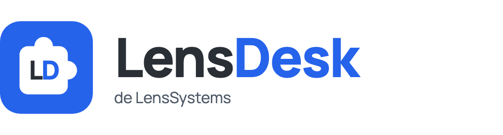
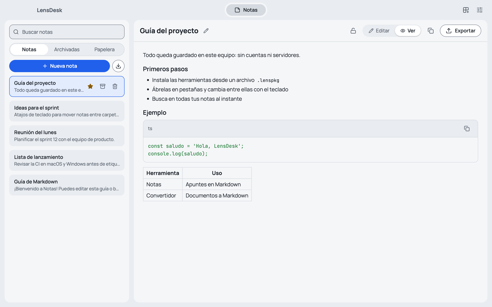
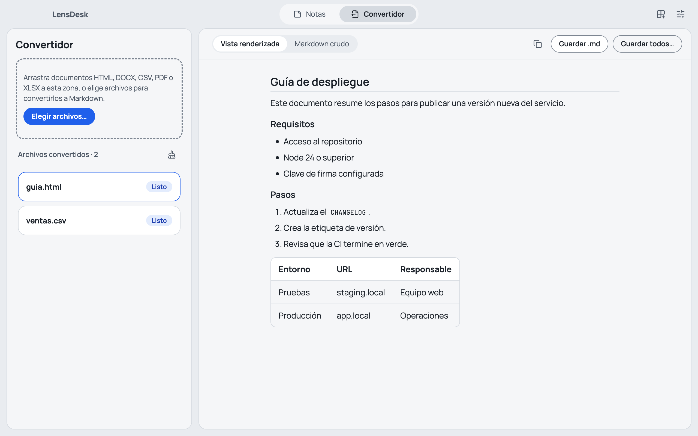
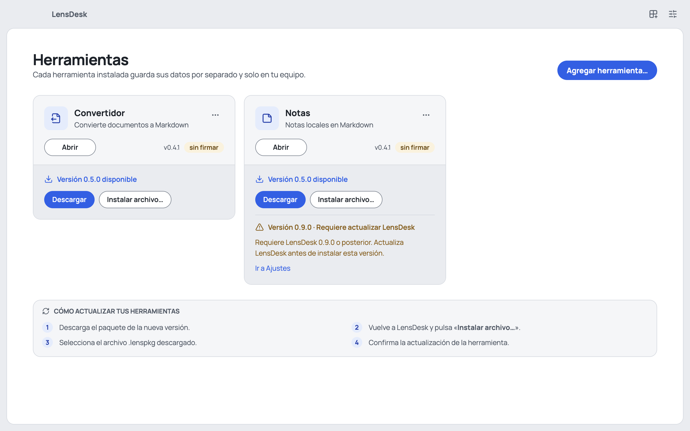
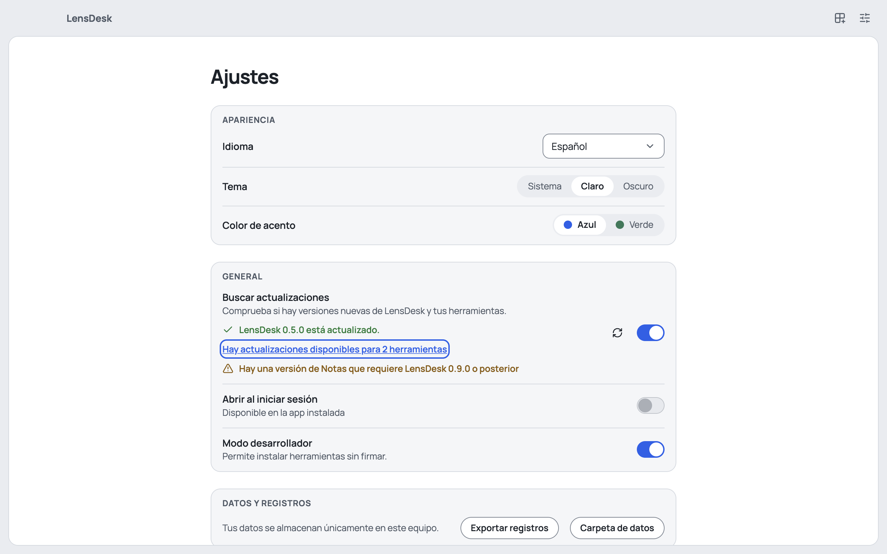

<div align="center">

<picture>
  <source media="(prefers-color-scheme: dark)" srcset="docs/images/logo-dark.png">
  
</picture>

<h1>LensDesk</h1>

**Un escritorio de herramientas para desarrolladores: modular, con pestañas y 100 % local.**

[](https://github.com/LensSystems/LensDesk/actions/workflows/ci.yml)
[](https://github.com/LensSystems/LensDesk/releases)
[](LICENSE)


[English](#lensdesk-english)

</div>

---

<div align="center">

<picture>
  <source media="(prefers-color-scheme: dark)" srcset="docs/images/notas-dark.png">
  
</picture>

</div>

LensDesk es una aplicación de escritorio que reúne tus utilidades de desarrollo en una sola
ventana. Cada herramienta se abre en su propia pestaña y se instala desde un paquete `.lenspkg`
firmado. Todo lo que haces se guarda en tu equipo: no hay cuentas, ni telemetría, ni servidores.

## Contenido

- [Características](#características)
- [Herramientas incluidas](#herramientas-incluidas)
- [Instalación](#instalación)
- [Primer arranque](#primer-arranque)
- [Instalar una herramienta](#instalar-una-herramienta)
- [Actualizaciones independientes](#actualizaciones-independientes)
- [Atajos de teclado](#atajos-de-teclado)
- [Privacidad y seguridad](#privacidad-y-seguridad)
- [Crear una herramienta](#crear-una-herramienta)
- [Arquitectura](#arquitectura)
- [Desarrollo](#desarrollo)
- [Limitaciones](#limitaciones)
- [Contribuir](#contribuir)
- [Licencia y autoría](#licencia-y-autoría)

## Características

- **Pestañas de herramientas:** abre varias herramientas a la vez y cambia entre ellas con el
  teclado. Las pestañas abiertas se recuerdan al reiniciar.
- **Instalación desde archivo:** cada herramienta es un paquete `.lenspkg` con firma Ed25519 y el
  hash SHA-256 de cada archivo. LensDesk verifica ambos antes de instalar.
- **Aislamiento:** cada herramienta corre en su propia vista con sandbox, con su propia sesión y su
  propia carpeta de datos, y su parte de servidor en un proceso aparte. Ninguna puede leer los
  datos de otra.
- **Permisos explícitos:** una herramienta declara qué necesita (`storage`, `files`, `backend`) y
  LensDesk rechaza todo lo demás.
- **Archivos sin rutas:** las herramientas nunca ven la ruta real de un archivo; reciben un permiso
  temporal para el archivo que tú elegiste.
- **Recuperación:** si una herramienta falla, solo se cierra su pestaña y puedes reabrirla con un
  clic; el resto sigue funcionando.
- **Español e inglés, tema claro y oscuro** (o el del sistema) y **color de acento azul o verde.**
- **macOS (Apple Silicon e Intel) y Windows x64.**

## Herramientas incluidas

Disponibles como paquetes separados; no se preinstalan con LensDesk.

| Herramienta | Qué hace |
|---|---|
| **Notas** | Notas en Markdown con editor con resaltado de sintaxis, vista previa, búsqueda de texto completo que resalta lo encontrado, notas fijadas, papelera, e importación y exportación de archivos `.md`. |
| **Convertidor** | Convierte documentos HTML, DOCX, CSV, PDF y XLSX a Markdown. Admite varios archivos a la vez, muestra el progreso, permite cancelar y guarda el resultado como `.md`. |
| **Ventas** | Ventas minoristas, inventario, crédito, caja, tickets históricos y respaldos locales. Paquete independiente 0.1.0: [guía](tools/ventas/docs/guia-es.md). |

<div align="center">

<picture>
  <source media="(prefers-color-scheme: dark)" srcset="docs/images/convertidor-dark.png">
  
</picture>

</div>

## Instalación

Descarga el instalador de la [última versión](https://github.com/LensSystems/LensDesk/releases):

| Sistema | Archivo |
|---|---|
| macOS con Apple Silicon | `LensDesk-<versión>-mac-arm64.dmg` |
| macOS con Intel | `LensDesk-<versión>-mac-x64.dmg` |
| Windows x64 | `LensDesk-<versión>-win-x64.exe` |

Cada release de LensDesk incluye `SHA256SUMS.txt` y copias exactas de paquetes oficiales
firmados: como máximo uno por herramienta, la mayor versión compatible con LensDesk 0.4.0
y API 1. Son snapshots para clientes antiguos; pueden omitir una herramienta incompatible
y no garantizan su última versión. No se preinstalan ni se reconstruyen o firman de nuevo.
Desde la carpeta donde guardaste las descargas:

```bash
shasum -a 256 -c SHA256SUMS.txt --ignore-missing
```

En Windows (PowerShell): `Get-FileHash .\LensDesk-<versión>-win-x64.exe` y compara el resultado
con la línea del archivo en `SHA256SUMS.txt`.

## Primer arranque

Las versiones distribuidas no están firmadas. En macOS, intenta abrir LensDesk una vez y después
ve a **Ajustes del Sistema → Privacidad y seguridad → Abrir de todos modos**. También puedes quitar
la marca de cuarentena con:

```bash
xattr -dr com.apple.quarantine /Applications/LensDesk.app
```

En Windows, cuando aparezca SmartScreen, selecciona **Más información** y después
**Ejecutar de todas formas**.

## Instalar una herramienta

En LensDesk, pulsa **Agregar herramienta…** y elige el archivo `.lenspkg` que quieras instalar.
Desde el menú **⋯** de cada tarjeta puedes ver sus detalles, desactivarla o quitarla.

<div align="center">

<picture>
  <source media="(prefers-color-scheme: dark)" srcset="docs/images/herramientas-dark.png">
  
</picture>

</div>

Un paquete sin firma solo se instala con el **modo desarrollador** activo (en Ajustes), y su
tarjeta lleva la insignia **sin firmar**.

Las herramientas instaladas no se actualizan solas. Descarga su paquete oficial y usa
**Instalar archivo…** o **Agregar herramienta…**; LensDesk verifica firma y hashes antes de
instalar. Los datos existentes se conservan al actualizar.

## Actualizaciones independientes

LensDesk y cada herramienta tienen versiones y publicaciones propias. En **Ajustes → Buscar
actualizaciones**, **Buscar ahora** consulta LensDesk y el catálogo oficial de herramientas.
Un enlace con el número de herramientas con actualización lleva a sus tarjetas, sin repetir la
consulta. Los resultados se conservan al volver a Ajustes.

Para cada herramienta instalada se ofrece la mayor versión posterior compatible con tu host y
API. Si existe otra más nueva incompatible, se muestra su aviso aparte; puedes instalar la
compatible intermedia. Las herramientas sin instalar no se anuncian. **Descargar** abre el archivo
en el navegador y **Instalar archivo…** permite elegirlo después: no hay descargas ni instalaciones
automáticas. Si falla una fuente, la otra conserva su resultado; los resultados previos se
identifican y no se presentan como recién comprobados.

Los componentes de interfaz van dentro de cada `.lenspkg`. Para recibir el indicador de selección
compartido y las mejoras de Notas o del Convertidor, instala sus paquetes actualizados (0.4.1);
actualizar solo LensDesk no cambia las herramientas ya instaladas.

Ejemplo ilustrativo con versiones y paquetes locales de prueba; no representa publicaciones nuevas.

<picture>
  <source media="(prefers-color-scheme: dark)" srcset="docs/images/actualizaciones-dark.png">
  
</picture>

## Atajos de teclado

En Windows, usa `Ctrl` donde dice `⌘`.

| Acción | Atajo |
|---|---|
| Página Herramientas | `⌘T` |
| Cerrar la pestaña | `⌘W` |
| Pestaña siguiente / anterior | `Ctrl+Tab` / `Ctrl+Shift+Tab` |
| Ir a la pestaña 1–9 | `⌘1` … `⌘9` |
| Ajustes | `⌘,` |

## Privacidad y seguridad

- **Tus datos no salen de tu equipo.** Las notas, los ajustes y los registros viven en la carpeta
  de datos de la aplicación (**Ajustes → Carpeta de datos**).
- **Solo el host consulta metadatos de actualización**, mediante dos GET fijos sin parámetros:
  `https://api.github.com/repos/LensSystems/LensDesk/releases/latest` y
  `https://lenssystems.github.io/LensDesk/tools-catalog-v1.json`. No envía IDs ni versiones de
  herramientas instaladas, notas, contenido ni rutas; los proveedores reciben la petición HTTP
  habitual, incluida la dirección IP. Las herramientas no realizan estas consultas.
- La búsqueda automática ocurre al arrancar si han pasado 24 horas desde la última consulta;
  no hay un temporizador diario continuo. **Buscar ahora** permite buscar manualmente y las
  búsquedas simultáneas se comparten. Con **Buscar actualizaciones** desactivado o repositorio
  vacío no se hace ninguna consulta, tampoco manual. Un repositorio alternativo válido puede
  consultar su release de app, pero no usa el catálogo oficial.
- Las respuestas rechazan redirecciones y tienen límite de 10 segundos: 512 KiB para la app y
  2 MiB para el catálogo. El catálogo público es informativo y no está firmado: no sustituye la
  firma Ed25519 ni los hashes que verifica el instalador. LensDesk no descarga ni instala nada
  por su cuenta. Abrir **Descargar** en tu navegador es una acción separada.
- **Sin contenido remoto:** la interfaz y las herramientas solo cargan archivos locales.
- **Los registros no guardan contenido:** solo eventos, códigos de error y longitudes, nunca el
  texto de tus notas ni rutas de archivos.
- Para reportar una vulnerabilidad, consulta [SECURITY.md](SECURITY.md).

## Crear una herramienta

Usa [`tools/_template`](tools/_template) como punto de partida:

1. Copia la carpeta a `tools/<tu-herramienta>`.
2. Define un `id` único (2–40 caracteres, letra minúscula inicial, letras, números y guiones),
   `name`, `description`, `icon`, permisos y entradas en `lensdesk.tool.json`. Cambia `name` en
   `package.json` y mantén su `version` igual a la del manifiesto (la plantilla inicia en 0.1.0).
   Declara `apiVersion: 1` y el mínimo real `minHostVersion`; no lo aumentes sin necesidad.
   Los textos de la interfaz están en `locales/es.json` y `locales/en.json`.
   El icono debe ser uno de los nombres de
   [`tool-icons.ts`](apps/desktop/src/renderer/src/shell/tool-icons.ts); si no, se usa `puzzle`.
3. Ejecuta `pnpm install` y genera el paquete con
   `pnpm --filter <nombre-del-paquete> run package`.
4. Añade pruebas del backend y de la interfaz; ejecuta `pnpm typecheck`, `pnpm lint`, `pnpm test`
   y `pnpm test tests/unit/locales-parity.test.ts`. Instala el `.lenspkg` de `dist/` con
   **Agregar herramienta…**; para el paquete local sin firma activa el modo desarrollador.
5. Para preparar una publicación oficial sin tag ni secretos reales, construye la herramienta y
   ejecuta `node packages/lenspkg/src/tool-release-cli.ts dry-run <id>-v<versión>` desde la raíz.
   Usa firma efímera local y no publica. Integra código y CI en `main` antes del tag oficial;
   sigue [Publicar una herramienta](CONTRIBUTING.md#publicar-una-herramienta). El workflow descubre
   manifiestos en `tools/` sin una lista fija ni cambios por cada herramienta nueva.

Una herramienta tiene una interfaz web (React u otra) que usa `createToolClient()` de
`@lensdesk/sdk` y los componentes compartidos de `@lensdesk/ui` (los ves todos con
`pnpm ui:gallery`), y opcionalmente una parte de servidor en Node que usa `defineBackend()` de
`@lensdesk/sdk/backend`, con SQLite en su propia carpeta de datos.

### Selectores compartidos

Usa el selector de `@lensdesk/ui` sin copiar flechas ni estilos del indicador. El chevrón
predeterminado cambia de orientación al abrir y respeta movimiento reducido. La plantilla
hereda el idioma de LensDesk; no necesita un selector de idioma propio.

```tsx
import { Select, SelectTrigger, SelectValue, SelectContent, SelectItem } from "@lensdesk/ui";

<Select value={mode} onValueChange={setMode} disabled={disabled}>
  <SelectTrigger aria-label="Modo" aria-invalid={invalid} aria-describedby={invalid ? "mode-error" : undefined}>
    <SelectValue placeholder="Elige un modo" />
  </SelectTrigger>
  <SelectContent>
    <SelectItem value="read">Lectura</SelectItem>
    <SelectItem value="edit">Edición</SelectItem>
  </SelectContent>
</Select>
```

El componente padre mantiene `mode`, `setMode`, `disabled` e `invalid`. Si hay error, muestra
su explicación con `id="mode-error"`. La galería (`pnpm ui:gallery`) demuestra normal,
hover, foco, deshabilitado, error y valores largos. Conserva el foco visible, un nombre
accesible y la selección por teclado. `icon` sigue disponible para una personalización
justificada; `icon={null}` oculta el indicador y omitirlo usa el diseño compartido.

## Arquitectura

```text
apps/desktop/            Aplicación Electron
├── src/main/            Proceso principal: ventanas, IPC validado, base de datos, instalador,
│                        procesos de las herramientas, registros y aviso de versión
├── src/preload/         Puentes mínimos hacia la interfaz y hacia cada herramienta
├── src/renderer/        Interfaz de LensDesk (React): pestañas, Herramientas y Ajustes
└── src/shared/          Canales IPC y tipos compartidos
packages/sdk/            SDK de herramientas: cliente, backend, manifiesto, errores y estilos
packages/lenspkg/        Formato .lenspkg: empaquetar, firmar, verificar y extraer (con CLI)
packages/ui/             Componentes de interfaz compartidos por LensDesk y las herramientas
tools/notes/             Notas
tools/md-converter/      Convertidor
tools/_template/         Plantilla para crear herramientas
scripts/                 Compilación de herramientas y smoke test
tests/                   Pruebas e2e con Playwright y pruebas de la documentación
```

**Hecho con** Electron, React, TypeScript, Tailwind CSS, Radix, zustand, i18next, zod, SQLite de
Node (`node:sqlite`), Vitest, Playwright, Biome, electron-vite y electron-builder.

## Desarrollo

Requisitos: Node indicado en `.nvmrc` y pnpm indicado en `package.json`.

```bash
pnpm install
pnpm dev          # con las herramientas del repositorio: LENSDESK_DEV_TOOLS_DIR=tools pnpm dev
pnpm format
pnpm lint
pnpm typecheck
pnpm test
pnpm test:e2e     # necesita pnpm build y pnpm tools:package
pnpm ui:gallery   # galería de componentes de @lensdesk/ui en claro y oscuro
```

Los detalles, las reglas del código y el proceso de publicación están en
[CONTRIBUTING.md](CONTRIBUTING.md); el historial de cambios, en [CHANGELOG.md](CHANGELOG.md).

## Limitaciones

- Las aplicaciones no están firmadas con certificado de Apple ni de Microsoft: el sistema pide
  confirmación la primera vez (ver [Primer arranque](#primer-arranque)).
- No hay actualización automática: LensDesk avisa de la versión nueva y abre su página.
- No hay tienda de herramientas: se instalan desde archivos `.lenspkg`.
- El Convertidor no lee PDF escaneados (sin texto seleccionable), omite las imágenes y acepta
  archivos de hasta 50 MB.
- Sin versión para Linux por ahora.

## Contribuir

Las contribuciones son bienvenidas. Lee [CONTRIBUTING.md](CONTRIBUTING.md) antes de abrir un pull
request. Para reportar vulnerabilidades usa el canal privado descrito en [SECURITY.md](SECURITY.md).

## Licencia y autoría

Distribuido bajo la licencia **MIT**; consulta [LICENSE](LICENSE).

Creado y mantenido por **[LensSystems](https://github.com/LensSystems)**.

---

# LensDesk (English)

**A modular, tabbed, 100% local desktop for developer tools.**

LensDesk brings your development utilities together in one window. Each tool opens in its own tab
and is installed from a signed `.lenspkg` package. Everything you do stays on your computer: no
accounts, no telemetry, no servers.

## Features

- **Tool tabs:** open several tools at once and switch with the keyboard. Open tabs are restored
  on restart.
- **Install from a file:** each tool is a `.lenspkg` package with an Ed25519 signature and a
  SHA-256 hash for every file. LensDesk checks both before installing.
- **Isolation:** each tool runs in its own sandboxed view, with its own session and data folder,
  and its backend in a separate process. No tool can read another tool's data.
- **Explicit permissions:** a tool declares what it needs (`storage`, `files`, `backend`) and
  LensDesk denies everything else.
- **Files without paths:** tools never see a real file path; they get a temporary grant for the
  file you picked.
- **Recovery:** if a tool crashes, only its tab closes and you can reopen it with one click.
- **Spanish and English, light and dark theme** (or the system one) and **blue or green accent color.**
- **macOS (Apple Silicon and Intel) and Windows x64.**

## Included tools

Available as separate packages; tools are not preinstalled with LensDesk.

| Tool | What it does |
|---|---|
| **Notes** | Markdown notes with a syntax-highlighting editor, preview, full-text search that highlights matches, pinned notes, trash, and `.md` import and export. |
| **Converter** | Converts HTML, DOCX, CSV, PDF and XLSX documents to Markdown. Handles several files at once, shows progress, can cancel, and saves the result as `.md`. |
| **Sales** | Retail sales, inventory, credit, cash, historical tickets and local backups. Separate 0.1.0 package: [guide](tools/ventas/docs/guide-en.md). |

## Installation

Download the installer from the [latest release](https://github.com/LensSystems/LensDesk/releases):
`mac-arm64.dmg` (Apple Silicon), `mac-x64.dmg` (Intel) or `win-x64.exe` (Windows). App releases
include `SHA256SUMS.txt` and exact copies of signed official packages: at most one per tool,
the highest version compatible with LensDesk 0.4.0 and API 1. These legacy snapshots may omit
incompatible tools and do not guarantee the latest tool version. They are not preinstalled,
rebuilt or signed again. To check your downloads, run `shasum -a 256 -c SHA256SUMS.txt --ignore-missing` in their folder (on
Windows, compare the output of `Get-FileHash` with the file's line).

## First launch

Distributed builds are unsigned. On macOS, try opening LensDesk once, then go to **System Settings
→ Privacy & Security → Open Anyway**. You can also remove the quarantine flag with:

```bash
xattr -dr com.apple.quarantine /Applications/LensDesk.app
```

On Windows, when SmartScreen appears, select **More info**, then **Run anyway**.

## Install a tool

In LensDesk, click **Add tool…** and choose the `.lenspkg` file you want to install. Unsigned
packages need developer mode turned on in Settings, and show an **unsigned** badge.

Installed tools do not update themselves. Download an official package and choose **Install file…**
or **Add tool…**; LensDesk checks its signature and hashes before installation. Updating preserves
the existing tool data.

## Independent updates

LensDesk and each tool have independent versions and releases. In **Settings → Check for updates**,
**Check now** checks LensDesk and the official tools catalog. The tool-update count links to their
cards without another request. Results remain available when you return to Settings.

For each installed tool, LensDesk offers the highest newer compatible version for your host and API.
If a later incompatible version exists, its warning is shown separately; the compatible intermediate
version remains available. Uninstalled tools are not announced. **Download** opens the file in your
browser; **Install file…** lets you choose it afterwards. Nothing downloads or installs automatically.
If one source fails, the other keeps its result; previous results are identified instead of being
reported as freshly checked.

UI components are embedded in each `.lenspkg`. Install updated Notes and Converter packages (0.4.1)
to receive their shared selector and interface improvements; updating LensDesk alone does not change
already installed tools. The screenshots use illustrative versions and local test packages;
they do not announce new published releases.

## Keyboard shortcuts

`⌘T` Tools page · `⌘W` close tab · `Ctrl+Tab` / `Ctrl+Shift+Tab` next / previous tab ·
`⌘1`…`⌘9` go to tab · `⌘,` Settings. On Windows, use `Ctrl` instead of `⌘`.

## Privacy and security

- **Your data never leaves your computer.** Notes, settings and logs live in the app data folder
  (**Settings → Data folder**).
- **Only the host requests update metadata**, using two fixed GET URLs without parameters:
  `https://api.github.com/repos/LensSystems/LensDesk/releases/latest` and
  `https://lenssystems.github.io/LensDesk/tools-catalog-v1.json`. No installed tool IDs or versions,
  notes, content or paths are sent. Providers receive the normal HTTP request, including your IP
  address. Tools do not make these requests.
- Automatic checks happen at startup after a 24-hour interval; there is no continuous daily timer.
  **Check now** allows manual checks, and simultaneous checks share requests. Disabling **Check for
  updates**, or configuring an empty repository, prevents all checks including manual ones. A valid
  alternate repository may supply app releases but is not associated with the official tools catalog.
- Responses reject redirects and have a 10-second deadline: 512 KiB for app metadata and 2 MiB for
  the catalog. The public catalog is advisory and unsigned; it does not replace the Ed25519 signature
  and hashes verified by the installer. LensDesk never downloads or installs packages itself.
  Opening **Download** in your browser is a separate user action.
- **No remote content:** the interface and the tools only load local files.
- **Logs hold no content:** only events, error codes and lengths, never note text or file paths.
- To report a vulnerability, see [SECURITY.md](SECURITY.md).

## Create a tool

Use [`tools/_template`](tools/_template) as the starting point:

1. Copy the folder to `tools/<your-tool>`.
2. Set a unique `id` (2–40 characters: initial lowercase letter, lowercase letters, digits and
   hyphens), `name`, `description`, `icon`, permissions and entry points in `lensdesk.tool.json`.
   Change `name` in `package.json`; keep its `version` equal to the manifest (the template starts
   at 0.1.0). Declare `apiVersion: 1` and the actual `minHostVersion` requirement without an
   unnecessary increase. UI texts live in `locales/es.json` and `locales/en.json`.
   The icon must be one of the names in
   [`tool-icons.ts`](apps/desktop/src/renderer/src/shell/tool-icons.ts); otherwise `puzzle` is used.
3. Run `pnpm install` and build the package with
   `pnpm --filter <package-name> run package`.
4. Add backend and UI tests; run `pnpm typecheck`, `pnpm lint`, `pnpm test` and
   `pnpm test tests/unit/locales-parity.test.ts`. Install the `.lenspkg` from `dist/` with
   **Add tool…**; turn on developer mode for the local unsigned package.
5. To prepare an official release without a tag or real secrets, build the tool and run
   `node packages/lenspkg/src/tool-release-cli.ts dry-run <id>-v<version>` from the repository root.
   It uses an ephemeral local signing key and does not publish. Integrate the code and CI into
   `main` before an official tag; follow [tool publishing](CONTRIBUTING.md#publicar-una-herramienta).
   The workflow discovers manifests in `tools/` without a fixed tool list or workflow changes for
   each new tool.

A tool has a web UI (React or another library) that uses `createToolClient()` from
`@lensdesk/sdk` and the shared components from `@lensdesk/ui` (browse them with
`pnpm ui:gallery`), and optionally a Node backend that uses `defineBackend()` from
`@lensdesk/sdk/backend`, with SQLite in its own data folder.

### Shared selectors

Use the `@lensdesk/ui` selector without copying indicator arrows or styles. The default
chevron changes direction when opened and respects reduced motion. The template inherits
LensDesk's language; it does not need its own language selector.

```tsx
import { Select, SelectTrigger, SelectValue, SelectContent, SelectItem } from "@lensdesk/ui";

<Select value={mode} onValueChange={setMode} disabled={disabled}>
  <SelectTrigger aria-label="Mode" aria-invalid={invalid} aria-describedby={invalid ? "mode-error" : undefined}>
    <SelectValue placeholder="Choose a mode" />
  </SelectTrigger>
  <SelectContent>
    <SelectItem value="read">Read</SelectItem>
    <SelectItem value="edit">Edit</SelectItem>
  </SelectContent>
</Select>
```

The parent owns `mode`, `setMode`, `disabled` and `invalid`. For errors, provide explanatory
text with `id="mode-error"`. The gallery (`pnpm ui:gallery`) demonstrates normal, hover,
focus, disabled, error and long-value states. Preserve visible focus, an accessible name
and keyboard selection. `icon` remains available for justified customization; `icon={null}`
hides the indicator and omitting it uses the shared default.

## Development

Requirements: Node from `.nvmrc` and pnpm from `package.json`.

```bash
pnpm install
pnpm dev
pnpm format
pnpm lint
pnpm typecheck
pnpm test
pnpm ui:gallery   # @lensdesk/ui component gallery, light and dark
```

See [CONTRIBUTING.md](CONTRIBUTING.md) for details and [CHANGELOG.md](CHANGELOG.md) for the
change history.

## Limitations

- The apps are not signed with an Apple or Microsoft certificate, so the system asks for
  confirmation the first time.
- No automatic updates, no tool store, no Linux build yet.
- The Converter does not read scanned PDFs, omits images, and accepts files up to 50 MB.

## License

Released under the **MIT** license; see [LICENSE](LICENSE). Created and maintained by
**[LensSystems](https://github.com/LensSystems)**.
